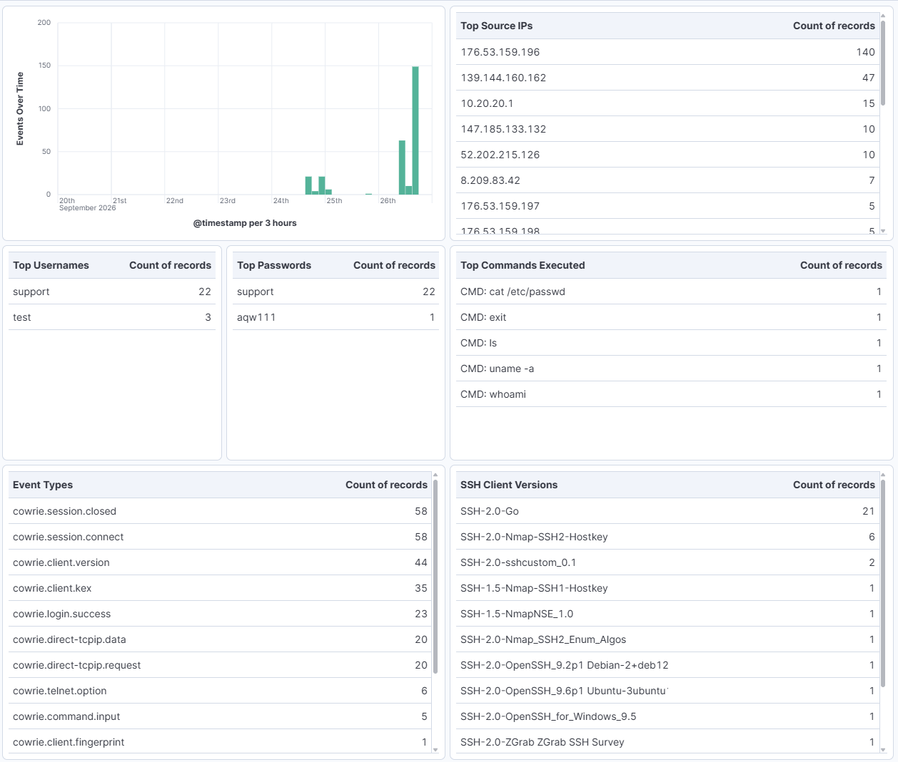
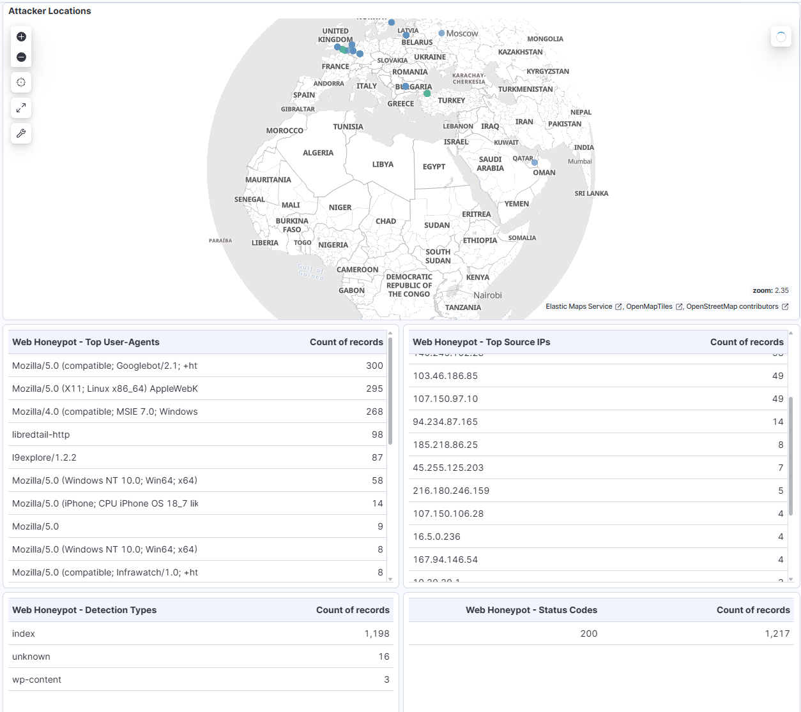

# pfSense + ELK Honeypot Lab

A home lab I built while studying to become an IT security specialist.
I wanted to see what real attack traffic looks like, and to practice
firewall rules, network segmentation and log analysis on real data
instead of a ready-made dataset.

## What it does

Two honeypots are exposed to the internet through port forwarding:

* **Cowrie** for SSH and Telnet
* **SNARE + TANNER** for web traffic. TANNER also tries to classify
  each request (for example SQL injection, XSS or plain recon), so I
  don't have to sort everything by hand.

Everything they log goes through Filebeat -> Logstash -> Elasticsearch,
gets GeoIP data added, and ends up in a Kibana dashboard.

## Network

pfSense sits in front of everything and splits the lab into three
networks:

* **WAN** - bridged to my home network, so the lab gets real internet
  access
* **DMZ** (10.20.20.0/24) - only the honeypots. They can reach
  HTTP/HTTPS and DNS through pfSense, nothing else, and they can't
  reach the management network
* **MGMT** (10.20.30.0/24) - the ELK stack. The honeypots can only
  reach it on port 5044, to send logs

More about the network: [docs/architecture.md](docs/architecture.md)

## Parts

|Part|What it is|
|-|-|
|[pfSense](docs/pfsense.md)|Firewall/router, network segments, NAT and port forwarding|
|[Honeypot](docs/honeypot.md)|Cowrie (SSH + Telnet), logs every session as JSON|
|[Web Honeypot](docs/web-honeypot.md)|SNARE + TANNER with a cloned decoy site|
|[ELK Stack](docs/elk-stack.md)|Log pipeline, GeoIP, Kibana dashboard|

## Dashboard

Shows events over time, source IPs, which usernames, passwords and
commands were tried, which web paths were requested, and where the
traffic comes from on a map. It covers both honeypots.

## Things that went wrong

A lot of the time went into fixing problems, and that's where I
learned the most. A few examples, with details in the docs:

* Turning on `ufw` after Docker was already running silently blocked
  all traffic to the web honeypot, through the `FORWARD` chain
  ([web-honeypot.md](docs/web-honeypot.md))
* Two bugs in SNARE itself that I had to fix before it worked
  ([web-honeypot.md](docs/web-honeypot.md))
* Kibana couldn't show the map because my test traffic came from a
  private IP, so the GeoIP fields were never created
  ([elk-stack.md](docs/elk-stack.md))
* My ISP blocks ports 22 and 23 from outside, so I had to use other
  external ports ([pfsense.md](docs/pfsense.md))

## Investigations

When something interesting showed up, I wrote it down in
[investigations/](investigations/): what happened, what I think it
means, and a MITRE ATT\&CK mapping where it fits. I tried to keep what
the logs actually show separate from my own guesses.

## Status

The lab went live on 2026-09-24 and is shut down now.
