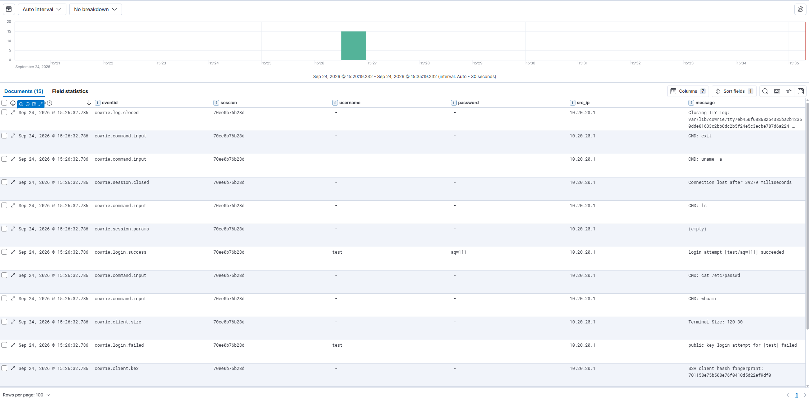

# ELK Stack

## Installation

- VM: Ubuntu Server 24.04 LTS, Generation 1, 2 vCPU, 8 GB RAM, 40 GB disk
- One network card, on Honeypot-MGMT only, static IP 10.20.30.10/24
- Elasticsearch 8.19.22 - security is on by default (TLS, built-in
  users). I reset the password after installing
- Kibana 8.19.22 - `server.host` set to 10.20.30.10 so I can reach it
  from outside the VM, enrolled with a token from Elasticsearch
- Logstash 8.19.22:
  - Beats input on port 5044 (Filebeat from both honeypots)
  - Elasticsearch output, indexing to `%{[log_type]}-%{+YYYY.MM.dd}`.
    That gives separate `cowrie-*` and `tanner-*` indices instead of
    mixing both honeypots in one
  - Uses Elasticsearch's self-signed CA cert (copied from
    `/etc/elasticsearch/certs/http_ca.crt` to `/etc/logstash/`)
- Checked that all services ran with `systemctl` and `journalctl`

Firewall rules for this VM are in [pfsense.md](pfsense.md).

## Log pipeline: Cowrie / SNARE+TANNER -> Filebeat -> Logstash -> Elasticsearch -> Kibana

- Filebeat 8.19.22 on both honeypot VMs:
  - Cowrie VM: filestream input reading
    `/home/cowrie/cowrie/var/log/cowrie/cowrie.json`, ndjson parser
    with `target: ""` so Cowrie's JSON fields end up at the top level.
    Tagged `log_type: cowrie`
  - Web honeypot VM: filestream input reading
    `~/tanner/docker/data/tanner/tanner_report.json` (one JSON object
    per line, like Cowrie's log). Tagged `log_type: tanner`
- Both send to Logstash at 10.20.30.10:5044. I didn't set up TLS
  between Filebeat and Logstash, since it's an internal network that's
  already segmented
- Tested end to end: I created the Kibana data views `cowrie-*` and
  `tanner-*`, and the events showed up in Discover with the right
  fields (Cowrie: session, eventid, src_ip, username, password,
  message; TANNER: peer.ip, path, method, status, headers,
  response_msg.response.message.detection)

*My own test session from inside the lab: a login and a few commands
in the fake shell, all parsed into separate fields.*

## GeoIP and the map

I added a geoip filter to the Logstash pipeline
(`10-geoip-filter.conf`) that looks up each event's source IP in the
bundled GeoLite2-City database. Logstash warned about the default
target field, so I set it to `source` instead of `geoip`, to follow
ECS naming.

Cowrie and TANNER name the source IP differently (`src_ip` vs
`peer.ip`), so the filter uses an if/else on `log_type` to pick the
right field. Both end up in the same `source.geo.*` fields, so one map
can show both honeypots.

The map still didn't work at first. Elasticsearch only creates a field
mapping the first time the field shows up in a document. All my test
traffic came from a private IP, which has no GeoIP data, so the geo
fields were never created and Kibana didn't see them as location
fields. I fixed it by defining the mapping myself in an index template
(for all future `cowrie-*` and `tanner-*` indices) and updating the
mapping on that day's index. The fields: source.geo.location
(geo_point), source.geo.country_name, source.geo.city_name,
source.geo.region_name, source.geo.country_code2.

## Kibana dashboard

The "Cowrie Honeypot Overview" dashboard covers both honeypots.

**Cowrie (SSH/Telnet):**
- Events Over Time - line chart over time
- Top Source IPs - `src_ip`
- Top Usernames / Top Passwords - filtered to remove Cowrie's
  placeholder value "-"
- Top Commands Executed - `message.keyword`, only
  `cowrie.command.input` events
- Login Outcomes - pie chart of `cowrie.login.success` vs
  `cowrie.login.failed`
- Event Types - all event types, including connections with no login
  or commands
- SSH Client Versions - the client string each scanner sends. This also
  shows non-SSH data, like a raw TLS ClientHello sent to the SSH port
  (see [Investigation 001](../investigations/001-initial-scanning-wave.md))

**Web honeypot (SNARE + TANNER):**
- Requested Paths - `path.keyword`
- Top Source IPs - `peer.ip`
- Top User-Agents - `headers.user-agent.keyword`
- Detection Types - what TANNER classified each request as
- Status Codes - `status`

**Both:**
- Attacker Locations (Kibana Maps) - one layer per honeypot, each with
  its own marker color, both using `source.geo.location`. The tooltips
  show different fields per layer since Cowrie and TANNER don't share
  field names, but both show city and country.

## Early things I noticed on the web honeypot

- SNARE seems to return its cloned index page (HTTP 200) for most paths
  it doesn't know, instead of a real 404. That's why "Detection Types"
  is mostly "index" even when lots of different paths were requested.
  A real WordPress site wouldn't do that, so the Status Codes panel
  needs to be read with that in mind.
- One source sent 300+ requests with a "Googlebot/2.1" User-Agent, but
  came from Linode/Akamai, not from Google. So the User-Agent was faked
  (see [Investigation 002](../investigations/002-recurring-credential-check-and-spoofed-recon.md)).
