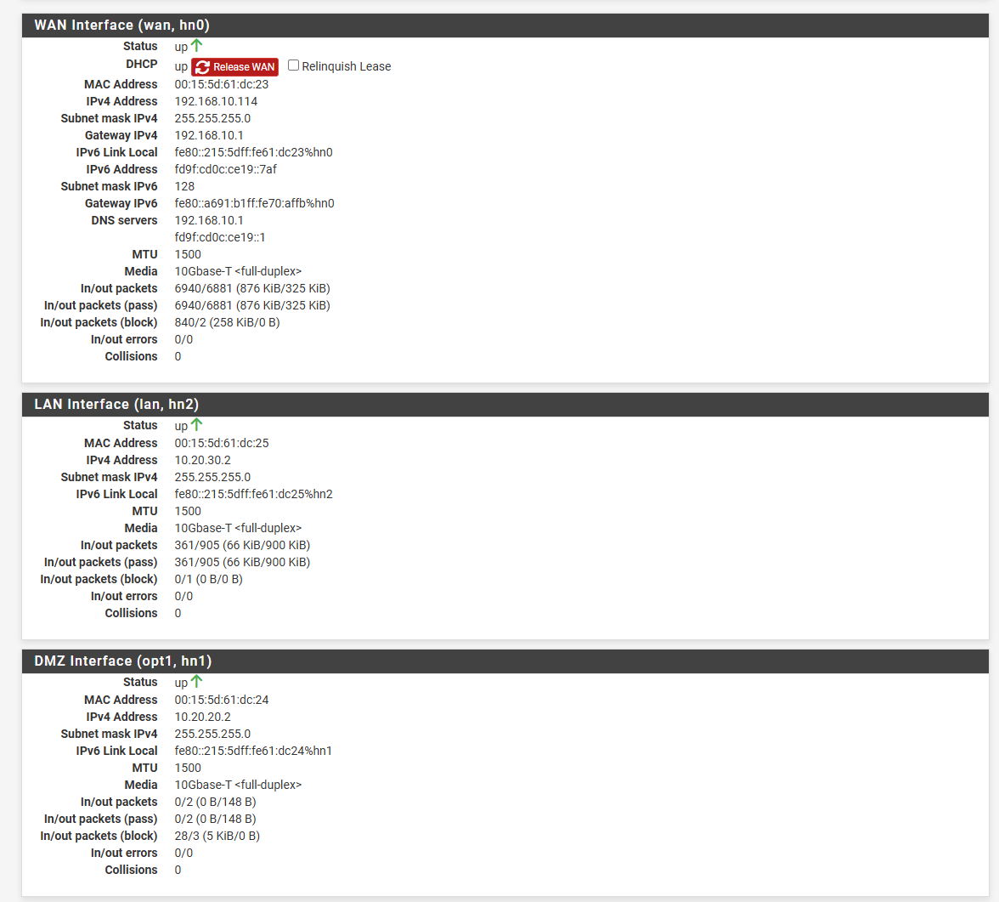
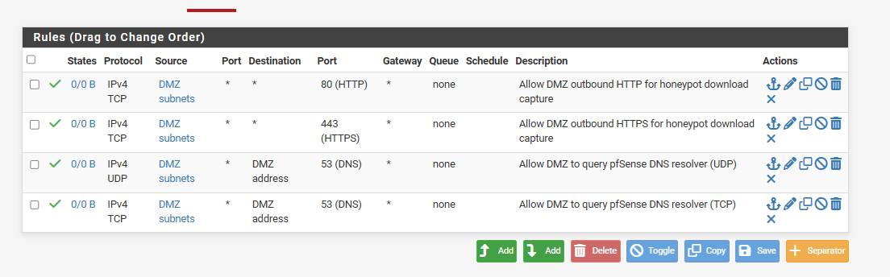
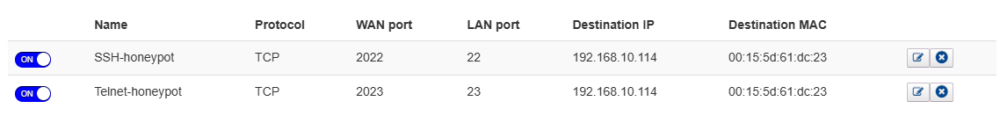

# pfSense

## Installation

- VM: Generation 1, 2 vCPU, 2 GB RAM, 20 GB disk (UFS)
- pfSense CE 2.9.0-RELEASE
- Interfaces:
  - WAN (hn0) -> Honeypot-WAN, DHCP from the home router (192.168.10.114/24)
  - LAN (hn2) -> Honeypot-MGMT, static 10.20.30.2/24
  - DMZ/OPT1 (hn1) -> Honeypot-DMZ, static 10.20.20.2/24
- SSH enabled on LAN, tested from the host (`ssh admin@10.20.30.2`)
- Changed the default admin password during install

*All three interfaces up, with the addresses above.*

## Firewall rules

### Locking down outbound traffic from the DMZ

I didn't want the DMZ fully open, but not fully closed either, so I
only allowed TCP 80 and 443 out. That way Cowrie can still record when
attackers try to download files (it has a built-in feature for that),
but the attack surface stays small.

Cowrie runs in medium-interaction mode, so commands like `wget` in the
fake shell are handled by Cowrie and never reach the real OS. The risk
I thought about was a bug in Cowrie/Python/Twisted that would let
someone break out and then use port 443 for C2 traffic. For a home lab
I accepted that, since I kept it patched, watched the logs, and the
rule could be turned off without breaking the honeypot.

Rules on the DMZ interface:
- Allow DMZ outbound TCP 80 (HTTP)
- Allow DMZ outbound TCP 443 (HTTPS)
- Allow DMZ outbound UDP 53 to the DMZ address (pfSense DNS resolver)
- Allow DMZ outbound TCP 53 to the DMZ address (pfSense DNS resolver)

Locking down outbound traffic broke DNS, because the honeypot was set
to use 1.1.1.1/8.8.8.8. I fixed it by pointing the honeypot's DNS at
pfSense's own DMZ address (10.20.20.2) with netplan, and adding rules
that allow DNS only to pfSense.

I also had to enable the DNS Resolver on the DMZ interface (Services >
DNS Resolver > Network Interfaces). Localhost had to stay selected too,
since pfSense uses the resolver via 127.0.0.1 for its own lookups.

The default WAN rules "Block private networks" and "Block bogon
networks" are still on. Their red "block" icon made me think they were
disabled at first, but the counters showed they were blocking traffic.

### DMZ -> MGMT (log shipping)

Only each honeypot's IP is allowed to reach the ELK VM's IP, on TCP
5044 (Filebeat -> Logstash). I kept it as narrow as I could, with no
access to whole subnets.

- `10.20.20.10 -> 10.20.30.10:5044` (Cowrie)
- `10.20.20.11 -> 10.20.30.10:5044` (Web-honeypot / SNARE + TANNER)

*All rules on the DMZ interface: HTTP/HTTPS out, DNS only to pfSense,
and the two log shipping rules to ELK.*

### MGMT/LAN

Uses pfSense's default "allow all" rule on LAN. It isn't facing the
internet, so I left it as it was.

## Port forwarding (home router -> pfSense -> honeypot)

Since pfSense sits behind my home router, there are two layers of NAT
(double NAT):

Home router:
- SSH honeypot: WAN port 2022 -> LAN 192.168.10.114:22
- Telnet honeypot: WAN port 2023 -> LAN 192.168.10.114:23
- Web honeypot: WAN port 80 -> LAN 192.168.10.114:80

pfSense (Firewall -> NAT -> Port Forward):
- WAN:22 -> 10.20.20.10:2222 (Cowrie SSH)
- WAN:23 -> 10.20.20.10:2223 (Cowrie Telnet)
- WAN:80 -> 10.20.20.11:80 (Web-honeypot / SNARE)

Two problems with my ISP:
- Port 22 on the router's WAN side is reserved by the ISP for their own
  remote management. I used port 2022 on the outside instead, forwarded
  to port 22 inside so the pfSense rule still matched.
- Port 23 (Telnet) was blocked by the ISP. My guess is normal ISP
  filtering, since Telnet is a common target for IoT botnets like
  Mirai. Same fix: port 2023 on the outside.

Port 80 worked directly.

I checked from outside with canyouseeme.org and by connecting over SSH
from mobile data. All three ports were reachable from the internet.

## ufw on the honeypot VMs

On the web honeypot VM I also used `ufw` to limit TANNER's admin ports
(8090/8091) to local access. That was harder than expected, because of
how `ufw` and Docker work together:

- `ufw` rules on `INPUT` don't cover ports that Docker publishes, since
  that traffic goes through `FORWARD`
- Turning on `ufw` after Docker was already running set the `FORWARD`
  chain's default policy to deny. That silently blocked all traffic to
  the containers, including the port forwarding from pfSense

Details in [Web Honeypot](web-honeypot.md).
